<!-- ANIMATED BANNER -->
<p align="center">
  
</p>

<!-- MINIMAL TECH BADGES -->
<p align="center">
  
  
  
  
  
  
  
  
</p>

> 🇧🇷 **[Versão em português → README.pt-BR.md](docs/README.pt-BR.md)**

---

## Overview

**Correio Elegante** is an interactive digital platform for sending high-fidelity themed virtual letters and cards. The project combines physics-based fluid animations and dynamic transitions (Framer Motion, GSAP, Lenis) with a robust backend wired to real payment gateways (PagBank for Pix, Stripe for credit cards). The flow guarantees the sender's message only becomes readable and shareable (via public link or QR Code) after automatic payment confirmation.

---

## Video demo

A 27s tour of the live deployment — landing, interactive envelope, plans, and the signature scratch-card reveal. Payment routes were mocked during capture; no real charge was created.

<p align="center">
  <video src="https://github.com/thisux1/thisux1/releases/download/demos/correioelegante3.webm" width="720" controls muted></video>
</p>

**[▶ Watch the demo (webm)](https://github.com/thisux1/thisux1/releases/download/demos/correioelegante3.webm)**

---

## Data Flow Architecture

The diagram below shows the continuous integration of the ecosystem, from letter creation by the user to final delivery through asynchronous payment webhooks:

<p align="center">
  
</p>

### Digital Letter Lifecycle

1. **Customization & Writing**: the sender composes the message in the frontend's visual editor, customizes aesthetic themes (colors, layouts, fonts) and attaches soundtracks or media (stored in the cloud via Cloudinary).
2. **Registration & Payment Intent**: the Express API validates the structured data with Zod schemas, creates a temporary inactive letter record in MongoDB Atlas (managed by Prisma ORM) and requests the Stripe checkout session or the PagBank Pix charge.
3. **Secure Payment**: the customer is redirected to the chosen gateway's official interface to complete the transaction securely.
4. **Confirmation & Webhook**: once the payment clears, the gateway sends a background HTTP POST notification (webhook) to the backend. The API validates the webhook signature, activates the letter in the database and generates the public sharing URL.
5. **Delivery**: the sender grabs the dynamic QR Code or copies the link to send to the recipient. Opening the link renders the letter with the sender's configured visual transitions and sound effects.

---

## Technical Details by Module

| Module / Component | Technologies | Role in the System |
| :--- | :--- | :--- |
| **Frontend Web App** | React 19, Vite, Tailwind CSS v4, Zustand, Framer Motion, GSAP, Lenis | Responsive Single Page Application (mobile-first) implementing a rich message editor, damped-physics animations (Framer Motion) and smooth scroll. |
| **Backend API Server** | Node.js, Express 5, TypeScript, JWT, Cookie Parser | Protected RESTful API responsible for account auth, checkout session creation, Zod request validation and webhook processing with signature cryptography. |
| **Database** | MongoDB Atlas, Prisma Client | Asynchronous document persistence (User and Message schemas) via typed Prisma schema modeling. |
| **Payment Providers** | Stripe SDK, PagBank API | Dual gateway offering Pix (dynamic QR code + configurable "copy & paste" code) and international credit cards. |
| **Media Storage** | Cloudinary SDK | Automated upload and optimization of user media attached during letter customization. |

---

## Running Locally

### Prerequisites
* **Node.js** (v18 or newer)
* Development keys for the third-party services (MongoDB, Stripe, PagBank, Cloudinary)

<details>
<summary><b>1. Clone & Install Dependencies</b></summary>
<br />

Install packages for both apps straight from the monorepo root:

```bash
# Install monorepo orchestration dependencies
npm install

# Install Frontend and Backend dependencies
npm install --prefix frontend
npm install --prefix backend
```
</details>

<details>
<summary><b>2. Configure Environment Variables</b></summary>
<br />

Create the API server environment config:

```bash
cd backend
cp .env.example .env
```

Open `backend/.env` and fill in your credentials:

| Variable | Description |
| :--- | :--- |
| `PORT` | API listen port (default: 3001) |
| `NODE_ENV` | Environment (`development` or `production`) |
| `FRONTEND_URL` | Allowed CORS origin (e.g. `http://localhost:5173`) |
| `DATABASE_URL` | MongoDB Atlas connection string |
| `JWT_SECRET` | Signing key for JWT access tokens |
| `JWT_REFRESH_SECRET` | Signing key for JWT refresh tokens |
| `CLOUDINARY_CLOUD_NAME` | Cloudinary cloud storage name |
| `CLOUDINARY_API_KEY` | Cloudinary API key |
| `CLOUDINARY_API_SECRET` | Cloudinary API secret |
| `STRIPE_SECRET_KEY` | Stripe test secret key (`sk_test_...`) |
| `STRIPE_WEBHOOK_SECRET` | Stripe webhook signature validation secret |
| `PAGBANK_TOKEN` | PagBank API access token |
| `PAGBANK_BASE_URL` | PagBank base URL (sandbox or production) |
</details>

<details>
<summary><b>3. Initialize the Data Model (Prisma)</b></summary>
<br />

Generate the Prisma typed client inside the backend directory:

```bash
cd backend
npm run prisma:generate
```
</details>

<details>
<summary><b>4. Run in Development</b></summary>
<br />

Runs backend and frontend together, both with auto-reload:

```bash
# From the repository root
npm run all
```

Once started:
* **Frontend SPA**: `http://localhost:5173`
* **Backend API**: `http://localhost:3001`
</details>

---

## Main Folder Structure

```path
correioelegante3/
├── frontend/          # React SPA — letter editor & premium animations
│   ├── src/
│   │   ├── app/       # Central routing & context initializers
│   │   ├── components/# Shared visual components (layout, UI, effects)
│   │   ├── editor/    # Customization-panel specific modules
│   │   ├── services/  # Axios-based HTTP communication layer
│   │   └── store/     # Global state management with Zustand
├── backend/           # Express REST API & Prisma schemas
│   ├── prisma/        # Relational data schema & MongoDB collections
│   ├── src/
│   │   ├── controllers/# Route validation & control logic
│   │   ├── middlewares/# Security, token & error interceptors
│   │   ├── routes/    # Exposed API endpoint mapping
│   │   └── services/  # Business rules & gateway adapters
└── docs/              # Documentation graphic assets
    ├── banner.svg     # Main animated banner
    └── architecture.svg# Flow & architecture diagram
```

---

## License

This project is under the terms of the [MIT License](LICENSE). Free to study, distribute and use.
